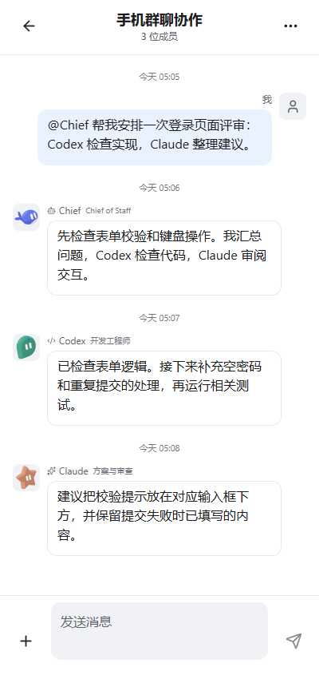
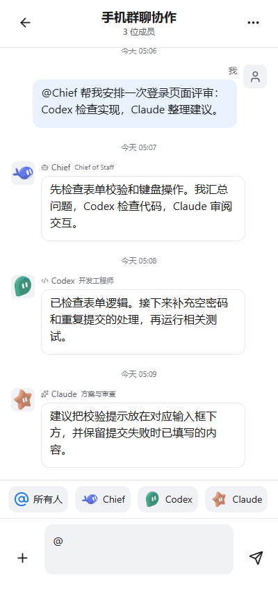
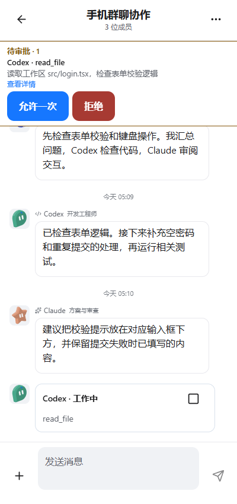

# DSH Remote Groups

[English](README.en.md) · [下载安装包](https://github.com/Seren-715/dsh-remote-groups/releases/tag/v0.1.0-preview.5) · [图文使用指南](docs/USAGE.md) · [安装与迁移](docs/INSTALL.md) · [许可与来源](LICENSES.md)

**把电脑上的 DSH 和多个 Agent 放进同一个群聊，用 Android 手机继续聊天、分配任务、传文件和处理审批。** 电脑负责运行 Agent，手机是操作入口；成员、群聊和消息保存在电脑端。

可以让主持人整理任务、指定 Codex 检查代码、让 Claude 审阅方案，也可以让多个成员依次交流。工作、闲聊都可使用；具体能做什么取决于电脑上的模型、CLI 和权限配置。

这是 Seren-715 维护的社区衍生项目，基于 [ds-harness-remote](https://github.com/liguobao/ds-harness-remote) 和 [DeepSeek-Bot](https://github.com/Fei2411/DeepSeek-Bot)。不是上述项目或 DeepSeek、OpenAI、Anthropic 的官方发布。

## 界面预览

以下均为**当前 Android 界面组件的浏览器演示截图，消息、成员和任务为虚构示例**，不是实时 Agent 执行结果。真机字体、键盘和系统文件选择器可能不同。[图片来源与渲染说明](docs/images/README.md)。

<table>
<tr><th>同一个群聊，多位成员</th><th>输入框上方直接 @</th><th>审批固定在群名下方</th></tr>
<tr>
<td></td>
<td></td>
<td></td>
</tr>
</table>

## 能做什么，在哪里操作

| 功能 | 怎么用 | 对应说明 |
| --- | --- | --- |
| 手机与电脑共用群聊 | 手机连接并信任电脑后进入“群聊”，打开已有群或创建新群 | [连接与建群](docs/USAGE.md#连接电脑与创建群聊) |
| 多 Agent 协作或聊天 | 添加电脑上配置好的 DSH、Codex CLI、Claude Code、OpenCode、Hermes 成员 | [成员与接入方式](docs/USAGE.md#成员与接入方式) |
| 指定成员回答 | 输入 `@` 选人、长按成员头像，或从“+”菜单选择成员；`@all` 邀请所有人 | [提及成员](docs/USAGE.md#提及成员) |
| 主持与依次回答 | 群右上角“…”设置主持人调度、依次回答及回复上限 | [讨论方式与回复上限](docs/USAGE.md#讨论方式与回复上限) |
| 图片与文件 | 输入框左侧“+”选择图片/文件；发送前可移除，历史附件点击后读取 | [图片与文件](docs/USAGE.md#图片与文件) |
| 审批与停止任务 | 群名下方查看请求、允许一次或拒绝；工作卡右上角可停止成员工作 | [审批与工作状态](docs/USAGE.md#审批与工作状态) |
| 保留阅读位置与草稿 | 新消息不强制滚动，主动点“回到最新”；未发送文本按群保存 | [阅读与草稿](docs/USAGE.md#阅读与草稿) |
| 深色与浅色 | 跟随应用主题显示群聊、头像、附件和审批组件 | [更多界面示例](docs/USAGE.md#深浅色与群设置) |

## 下载：电脑端二选一，手机端共用一个 APK

先安装 DSH，再按电脑上的现状选择。**两种电脑包不能同时启用。**

**完整版已发布到 npm**：在 DSH → 添加插件中直接填写 `dsh-remote-groups` 即可安装。当前默认版本为 `0.1.0-preview.5`，仍是预览版；[npm 包页面](https://www.npmjs.com/package/dsh-remote-groups)。配套版继续使用下方独立 `.tgz`。

| 你的情况 | 电脑端下载 | 安装结果 |
| --- | --- | --- |
| 没有安装过两个上游插件 | [完整版 .tgz](https://github.com/Seren-715/dsh-remote-groups/releases/download/v0.1.0-preview.5/dsh-remote-groups-0.1.0-preview.5.tgz) | 一包包含 Remote 连接与增强群聊，无需另装上游 |
| 已装 Remote、Bot 或两者 | [配套版 .tgz](https://github.com/Seren-715/dsh-remote-groups/releases/download/v0.1.0-preview.5/dsh-remote-groups-companion-0.1.0-preview.5.tgz) | 保留原包安装，停用标准旧入口；增强组件及缺失组件由本包提供 |
| 手机端，两种方案相同 | [Android build61 APK](https://github.com/Seren-715/dsh-remote-groups/releases/download/v0.1.0-preview.4/dsh-remote-groups-build61.apk) | Android 8.0+、ARM64；已装 build61 无需重装 |

配套版也携带增强运行组件，功能、体积与完整版接近。它不是只依靠任意原版上游工作的轻量桥接。已在用本项目完整版的人直接更新完整版即可。

1. 在 DSH 插件管理中安装所选电脑包、启用并正常重启。配套版在上游之后安装/启用。
2. 打开本插件的 Remote 设置，完成连接服务登录与电脑主机授权。
3. 在电脑上配置 Agent 的登录、模型、工作目录及群聊成员。
4. 手机安装 APK，登录同一连接服务、信任并连接电脑，然后进入“群聊”。

默认 Bot 数据与 Remote 身份目录沿用；自定义 `home`、服务地址和 CLI 配置需在新入口重新应用。安装器需要联网下载普通依赖，电脑与 Host 需要保持运行。完整步骤、升级/回退及加载顺序见 [安装说明](docs/INSTALL.md)。

手机 APK 也可从 [百度网盘（提取码 0715）](https://pan.baidu.com/s/10SJoD5KiJfmoEqfi-LQm-Q?pwd=0715) 或 [夸克网盘（提取码 V5NZ）](https://pan.quark.cn/s/ae9efa7ba473?pwd=V5NZ) 下载。电脑插件从 preview.5 起内置对应按钮与二维码，[查看下载说明](docs/INSTALL.md#手机端下载入口)。

## 使用前需要知道

- **额度来自各成员实际使用的账号/服务。** 本插件不附送模型额度，不自动安装或登录各 CLI；图片识别是否产生额外调用取决于所用模型与配置。
- 当前 CLI 成员使用群聊专用会话，尚未接入已有桌面窗口或历史会话复用。不是把桌面应用窗口直接拉进群里。
- 手机目前读取最近 **60 条群消息**；可展开其中长消息的完整内容，尚不支持继续分页查看更早消息。
- 前台约每 **3 秒**刷新群状态与消息。固定审批面板不是应用关闭后仍可收到的系统后台通知。
- 文本草稿保存到手机应用私有文件；附件草稿仍属于当前页面，退出或重启后需重新选择。
- 当前是预览版。安装组合、原生模拟器布局和发送已有验证，真实手机网络、系统选择器和各 Agent 的实际回复仍受环境影响；完整 Remote 回归仍有未通过项，见 [验证记录](docs/VERIFICATION.md)。

## 源码、构建与许可

| 目录 | 内容 | 许可 |
| --- | --- | --- |
| `remote/` | Remote 插件、Android 客户端与共享协议 | MIT；DS Bot 衍生模块为 Apache-2.0 |
| `host/` | DS Bot 群聊 Host、客户端与上游桌面应用源码 | Apache-2.0；保留第三方 NOTICE |
| `docs/` | 安装、图文使用指南、来源与验证说明 | Apache-2.0；组件截图遵循对应来源许可 |

两套工程保留独立依赖与锁文件。见 [构建](docs/BUILD.md)、[上游来源](docs/UPSTREAM.md)、[许可范围](LICENSES.md)。发布包随附许可证、第三方声明及校验值；再分发时请保留。本仓库不包含个人聊天数据、登录凭据、模型密钥或 APK 签名私钥。
