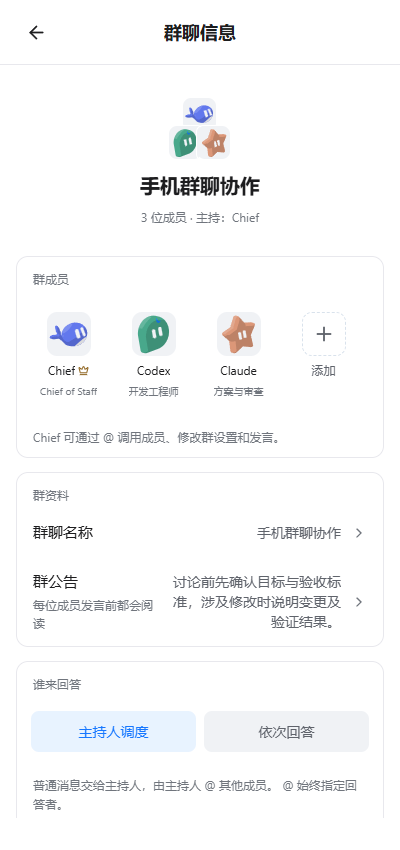
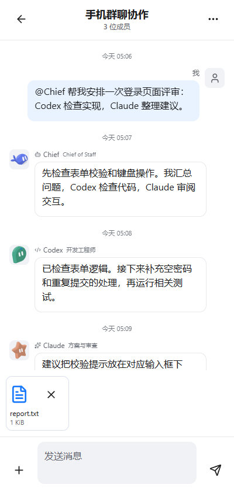
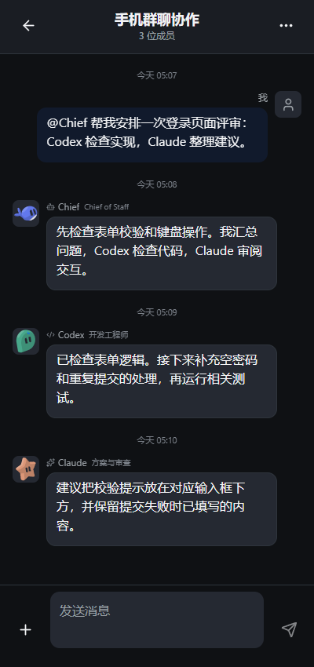

# DSH Remote Groups 图文使用指南

[返回首页](../README.md) · [下载安装包](https://github.com/Seren-715/dsh-remote-groups/releases/tag/v0.1.0-preview.4) · [安装与迁移](INSTALL.md)

本指南对应电脑插件 preview.4 与 Android build61。下面图片使用当前 Android 组件在浏览器中渲染，所有消息与任务为虚构示例，不代表真实 Agent 调用或真机效果。界面字体、键盘、文件选择器以实际手机为准。

## 连接电脑与创建群聊

先按 [安装说明](INSTALL.md) 选择完整版或配套版。两个版本使用同一个手机 APK；配套版可补齐缺失组件，保留原上游包安装，但不自动复制自定义配置。

1. 电脑保持 DSH 和本插件运行，在 Remote 设置中完成连接服务登录与主机授权。
2. 手机登录同一连接服务，信任并连接这台电脑，再打开“群聊”。
3. 已有群直接点开。新建时点“新建群聊”，从电脑已创建的成员里选择至少 2 位，填写名称并选择回答方式。
4. 如需新建 CLI 成员，先回电脑端添加、配置可执行命令和工作目录，并确认其账号可用；手机负责从现有团队里选成员。

电脑负责执行，手机负责发送和查看。手机连接成功并不等于某个 Agent 的模型调用一定可用。

## 成员与接入方式

| 成员类型 | 运行位置 | 使用前准备 |
| --- | --- | --- |
| DSH 成员 | 电脑 DSH Agent 会话 | 在 DSH 配置模型与账号，并给成员选择可用模型 |
| Codex CLI | 电脑本地 CLI | 安装 CLI、完成登录，在电脑端添加对应成员 |
| Claude Code | 电脑本地 CLI/适配器 | 配置所需 CLI 与运行依赖，确认账号与模型可用 |
| OpenCode | 电脑本地 CLI | 安装并配置其模型/服务商，再添加成员 |
| Hermes | 电脑本地 CLI | 配置本地运行环境、模型与账号，再添加成员 |

群里显示的是成员名称，未必等于实际模型名。名字叫“gpt”的成员用了哪里的额度，要看该成员的运行方式和模型配置。插件、手机 APK 本身不提供模型额度。

当前使用群聊专用会话，未接入已有 Codex/Claude 等桌面应用窗口和历史会话。不同成员对图片、文件和工具的支持也取决于自身运行环境。

## 提及成员

**操作入口就在输入框附近：**

- 输入 `@`，从输入框紧上方的候选条选择成员；继续输入名字可缩小候选范围。
- 长按某位成员的消息头像或工作中头像，插入对该成员的提及。
- 点左侧“+”，也能选择群成员或“@所有人”。

例如给名为 Codex 的成员发送 `@Codex 检查登录页面的重复提交问题，先说明修改计划。`，即可指定回答对象。使用 `@all` 邀请所有成员；它不代表所有 CLI 会并行执行，也不绕过回复上限。

## 讨论方式与回复上限

点群右上角“…”进入“群聊信息”。

| 设置 | 普通消息会如何处理 | 适合的用法 |
| --- | --- | --- |
| 主持人调度 | 先交给主持人，主持人可通过 @ 调用其他成员 | 让一位成员拆分任务、汇总意见 |
| 依次回答 | 依次交给成员，主持人优先 | 顺序收集多个成员的意见 |
| 直接 @ | 优先指定被提及的回答者 | 找某个成员继续工作或单独提问 |

在同一页面下方设置“最多回复轮数”，支持 **1–40**，留空使用默认回复预算。这个值表示**累计成员回复数，包含 @ 接力**，不是每位成员各答 N 次，也不是全员循环 N 轮。设为 1 只听首位成员；设为 3 也不保证三位成员各答一次。

群成员最多 12 位、至少保留 2 位。从“群成员”点头像可管理成员，点“添加”从电脑团队中补充成员。公告是每位成员发言前都会阅读的共同说明，适合填写目标、约束和验收要求。

## 图片与文件

1. 点输入框左侧“+”，选择“发送图片”或“添加文件”。
2. 选中的附件出现在输入框上方，发送前可逐个移除，也可附上一段文字。
3. 点发送，上传时显示进度并提供取消操作；保持手机与电脑连接。
4. 之后点历史消息里的附件卡片，从电脑按需读取。图片可打开大图；文件交给 Android 中支持该格式的应用打开。

当前每条消息最多 **8 个附件**，其中最多 **4 张图片**；单个附件不超过 **20 MiB**，图片合计不超过 **30 MiB**。模型能否理解内容、CLI 能否读取文件，还取决于成员配置和工作环境。

图片消息显示用户原文和图片，不把模型识图产生的辅助描述塞进聊天气泡。辅助识别文字仍可能供模型使用，并不意味着内部完全不识图或不会产生模型调用。上图演示的是“发送前附件卡片”，不是已经上传成功的凭证。

附件草稿未持久保存，退出页面或重启后请重新选择。电脑上的文件也不因此自动同步成手机本地相册或文件库。

## 审批与工作状态

请求审批时，卡片固定显示在群名称下方。即使正在查看前面的消息，也不必翻到最底部找审批。

- 点“查看详情”打开详情弹窗，检查 Agent、工具和请求内容。
- 点“允许一次”处理这一次请求，或点“拒绝”。不能在手机回答的请求会提示回电脑处理。
- 成员正在执行时显示工作卡；右上角停止按钮停止该成员在此群中的工作。

DSH 权限预设用于 DSH 成员，本地 CLI 仍由自身权限系统控制。停止按钮不是撤销已经执行的文件修改。

审批出现不会强制滚到聊天底部。**固定卡片属于群聊页面，不是手机系统后台推送**；当前页面在前台、连接有效时约每 3 秒刷新群状态与消息。

## 阅读与草稿

第一次进入群聊会定位最新消息。之后新消息或新审批到来，都不会强制把正在阅读的历史拉到底部；需要时点击“新消息 · 回到最新”。长消息可展开，并按需读取全文。

手机当前读取电脑保存的最近 **60 条群消息**，暂不支持继续分页读取更早消息。长消息展开与“读取更多条历史”是两种不同能力。

输入框文本按连接服务、账号、电脑、群聊分别保存到手机应用私有文件。退出群聊或重启应用后可恢复；成功发送后清空对应已发送文本。若出现“草稿暂未保存到手机”，请先保留当前页面，不要把未保存提示当成已持久保存。附件草稿不在此保证范围内。

## 深浅色与群设置

群聊随应用主题显示深色或浅色。除上图的聊天区域外，成员选择、附件、工作状态和审批也使用主题配色。

群右上角“…”还可以调整名称、公告、工作目录、权限预设、置顶与隐藏。工作目录是**电脑上的绝对路径**，留空跟随成员原设置；不要填写手机文件路径。隐藏后仍可搜索群；删除群会归档记录，团队成员仍保留。

## 连接成功但成员没回复时

先核对消息是否直接 @ 了某位成员，以及当前回答模式、回复上限和审批卡，再到电脑确认该成员的 CLI、模型账号和工作目录是否可用。仅有 CLI 登录状态不能证明模型请求一定成功；具体错误以电脑端执行结果为准。

图片能上传也不证明每位成员都具备识图能力。实际额度由各成员使用的服务承担。当前支持范围与已有测试、未通过项见 [验证记录](VERIFICATION.md)，安装/迁移问题见 [安装说明](INSTALL.md)。
