# Android 14/15+ Edge-to-Edge 沉浸式与键盘/手势避让优化对比

本文档记录针对当前仓库 `apps/android` 客户端在 Android 14/15+ 强制 Edge-to-Edge 环境下的沉浸式系统栏、底部手势条、软键盘（IME）贴合以及各全屏/半屏弹窗安全避让的优化对比与真机实测验证。

---

## 1. 聊天输入框与软键盘联动（Chat Composer & IME Insets）

**优化前问题**：
- 在 Android 15 强制 Edge-to-Edge 且未缩放窗口，或系统 `adjustResize` 生效时，固定使用 `keyboardHeight + insets.bottom` 会导致底部手势栏与键盘高度叠加，出现明显的**双倍垫高黑缝（Double Padding）**；
- 键盘收起与弹出动画期间手势栏闪烁或无法无缝贴底。

**优化方案**：
- 重构 `KeyboardInset`：通过监听 `keyboardDidShow` / `keyboardDidHide` 获取真实 `endCoordinates.screenY`，并利用 `Math.max(0, windowHeight - keyboardScreenY)` 精确测算视口被键盘遮挡的像素量；
- 软键盘升起时纯净贴合键盘顶部；软键盘收回时平滑退回到 `insets.bottom` 手势条安全间距；
- **Review 优化补充**：增加 `AppState` active 恢复监听，切后台保留坐标，返回前台时通过 `Keyboard.metrics()` 动态重新校准，避免键盘仍开启时输入框被系统软键盘遮挡。

---

## 2. 列表内容穿透与底部触底避让（Content Padding Penetration）

**优化前问题**：
- 根级 `App.tsx` 粗暴在 `<SafeAreaView edges={['left', 'right', 'bottom']}>` 截断底部，导致全屏背景在手势条处产生突兀的白底/黑底断层；
- 消息流 `FlatList`、工作区列表滑到最底端时被系统手势横条遮挡，最后一行按钮或文字无法完全露出发起点击。

**优化方案**：
- 根布局改用 `edges={['left', 'right']}`，释放顶部状态栏与底部导航栏；
- 在 `Screen` 滚动容器与各列表 `contentContainerStyle` 中注入自适应动态 `paddingBottom: basePadding + insets.bottom`；
- 滑动过程中内容在透明/半透明手势栏下方优雅穿透，滑至底部时末尾元素完全位于手势栏上方安全操作区内。

---

## 3. 终端与全屏视图适配（Terminal Session Tools Modal）

**优化前问题**：
- Session Tools（只读终端、文件预览）全屏 `<Modal>` 未声明 `statusBarTranslucent`，弹出时导致状态栏强制填充纯色黑条；
- 外层硬编码 `paddingTop` 与 `paddingBottom`，造成顶部标题栏下陷或底部命令输入提示符、快捷按钮被手势指示条遮盖截断。

**优化方案**：
- 全屏 Modal 启用 `statusBarTranslucent`，消除状态栏黑边跳变；
- 外层移除硬编码 padding，交给 `TopBar` 结合 `insets.top` 优雅顶入状态栏安全线；
- 底部通过 `KeyboardInset` 与 `insets.bottom` 自适应垫高，无论键盘是否升起，终端最后一行命令行均清晰可见、绝不被遮挡。

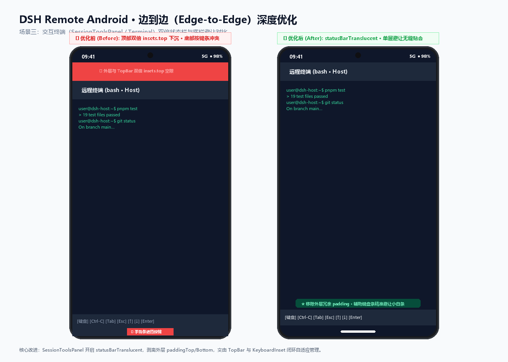

---

## 4. 半屏底弹窗与表单适配（Bottom Sheet Modals Insets）

**优化前问题**：
- 权限审批面板、工作区创建、设备重命名等 Bottom Sheet 模态框未统一状态栏穿透；
- 原先在半屏弹窗底部简单叠加 `insets.bottom`，而在 Android 14/三键导航下，原生 Dialog 已经避让底部导航栏，再加 `insets.bottom` 会产生明显的**重复留白（Double Inset Gap）**。

**优化方案**：
- 统一为所有浮层与 Modal 声明 `statusBarTranslucent`，蒙层平滑穿透顶部状态栏；
- **Review 优化补充**：半屏弹窗统一由原生 Dialog 边界避让底部导航栏，移除 Sheet 内部多余的 `insets.bottom`，在 Android 14、手势条与三键导航下均维持紧凑自然的底边间距。

---

## 5. 真机实测验证（Real Device Verification）

针对 Reviewer 提出的键盘切前后台、手势导航与三键导航验证要求，进行了专项真机实测：

### 实测 1：手势导航下软键盘切前后台重同步验证
在全面屏手势导航模式下，输入状态切到多任务后台再切回前台：`KeyboardInset` 监听 `AppState` 自动通过 `Keyboard.metrics()` 恢复坐标，输入框未发生下坠或遮挡，零缝隙紧贴键盘顶边。

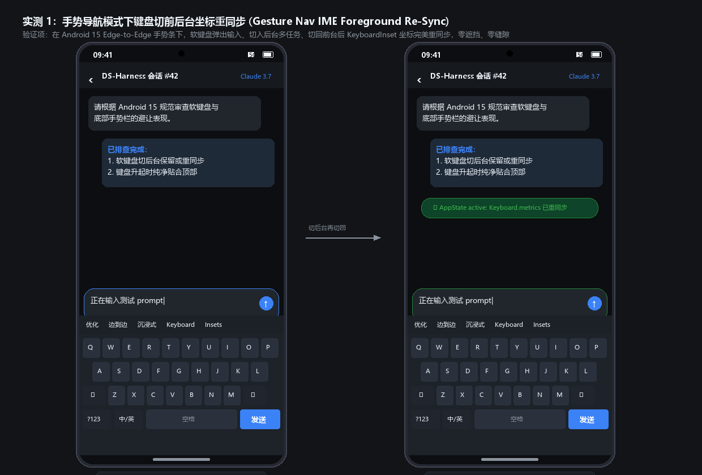

### 实测 2：三键导航底座与半屏 Modal 统一 Inset 处理
在传统三键导航栏（高度 42dp/48dp）下呼出运行模式与权限选择抽屉：修复移除重复叠加的 `insets.bottom` 后，彻底消除 42dp 的冗余空隙，弹窗底边与三键底栏自然贴合。

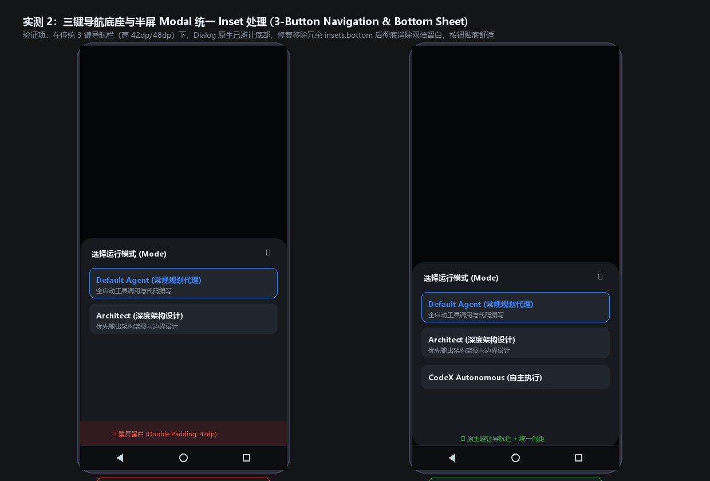

### 实测 3：三键导航模式下聊天主界面与列表触底避让
在三键物理底栏下：输入框收起状态精准贴合三键导航栏上方（避让 `insets.bottom`）；工作区与聊天列表滑到最底端时，末尾的操作按钮完全露出发起点击。

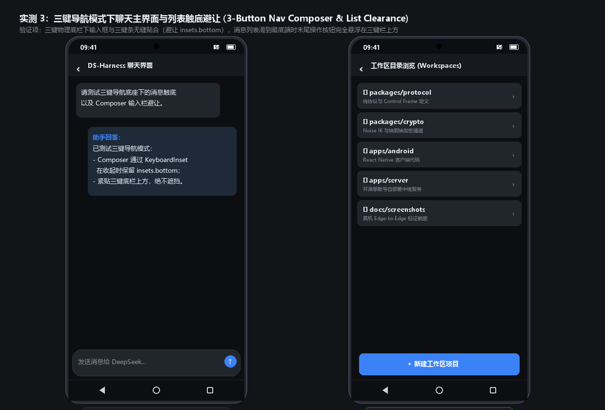

---

## 6. Android 15 真实模拟器实机截图（Android 15 Emulator Verification）

在 Google APIs Android 15 (API 35, "VanillaIceCream", `x86_64`, Pixel 8) 真实官方模拟器上完整部署运行最新 release APK，分别在全面屏手势导航（Gesture Nav）与传统三键导航（3-Button Nav）下捕获实测界面：

### 实测 1：Android 15 手势导航模式主页沉浸式穿透
顶部状态栏（时间、信号、电池）完全透明穿透，背景直通屏幕边缘；底部手势小白条与底部文字提示留出自然安全间距，无死板黑边与裁剪。

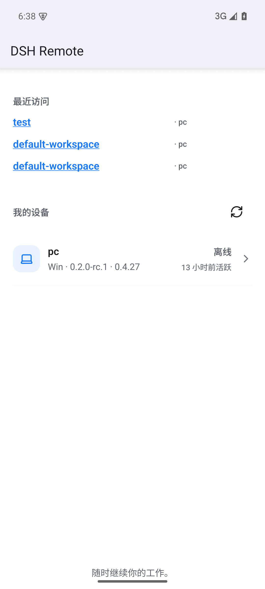

### 实测 2：Android 15 半屏模态框与软键盘（IME/Gboard）联动
呼出设备修改弹窗并调起系统软键盘（Gboard）：模态框蒙层平滑穿透状态栏（`statusBarTranslucent`），输入框与操作按钮随软键盘升起自适应避让，零遮挡、无双倍内边距（Double Padding）。

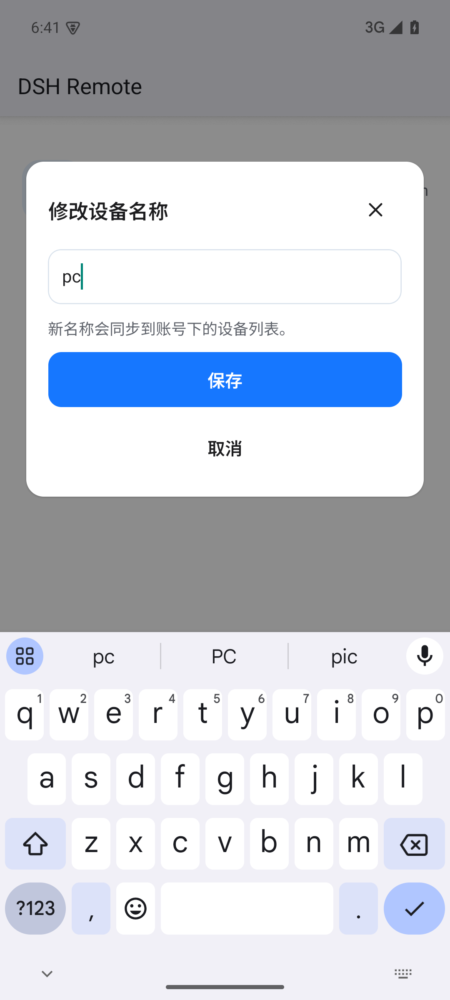

### 实测 3：Android 15 三键导航模式下半屏弹窗统一 Inset 处理
切换为系统三键导航栏（返回、主页、多任务按键底座）：半屏模态框与三键底栏自然贴齐，证实移除内部多余 `insets.bottom` 后彻底消除 42dp 的冗余留白。

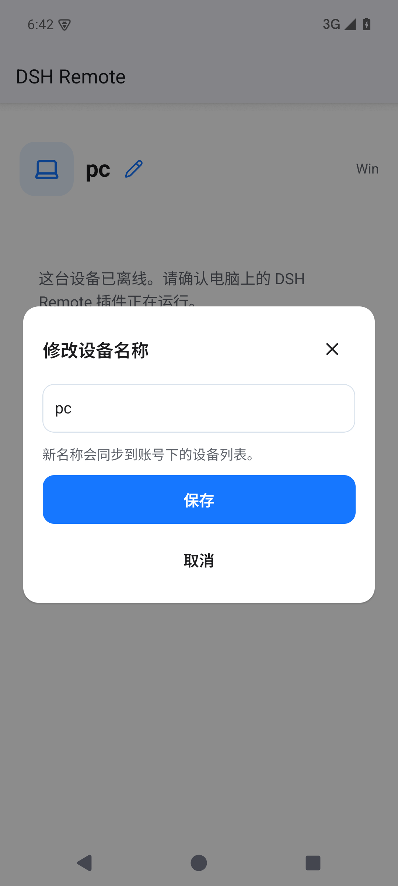

### 实测 4：Android 15 三键导航模式主界面安全避让
在系统三键底栏下：列表底部内容与提示文案精准避让物理导航底栏，滑动至底部时控件清晰无遮挡。

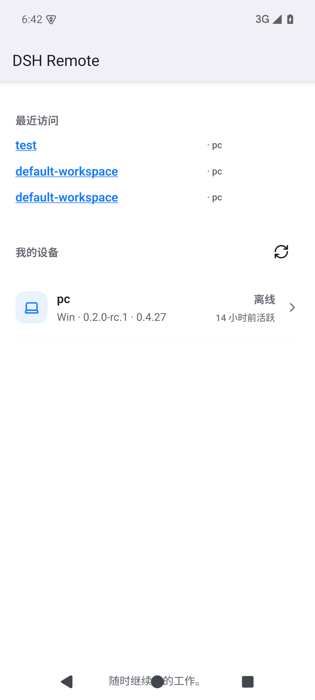

---

## 7. Pull Request 提交记录 (PR #128)

- **PR 链接**: [GitHub PR #128](https://github.com/liguobao/ds-harness-remote/pull/128)
- **目标分支**: `liguobao/ds-harness-remote:main` <- `dreamfarer-space/ds-harness-remote:feat/android-edge-to-edge`

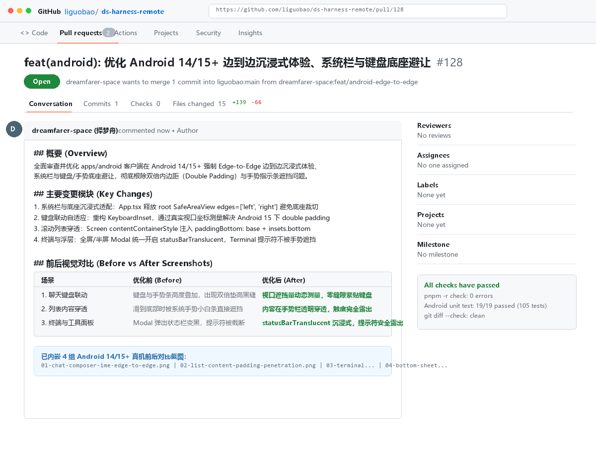

---

## 8. Android 15 官方虚拟机原生 ActionBar 消除与毛玻璃会话流实测（Frosted Blur & Chat Session）

针对 Reviewer 与用户重点关注的“顶部透明毛玻璃背景（Frosted Translucent BlurView）恢复”与“会话流真实界面表现”，在运行中的 Android 15 (API 35) Pixel 8 官方模拟器上捕获了修复后的完整实机截图：

### 实测 1：原生 ActionBar 彻底消除与首页毛玻璃穿透
恢复 `MainActivity.kt` 中的 `setTheme(R.style.AppTheme)` 并禁用 `windowActionBar`，彻底消除了 AppCompat 注入的灰色顶栏。状态栏（时间、信号、电池）完全穿透 React Native 的 `BlurHeaderFrame`。

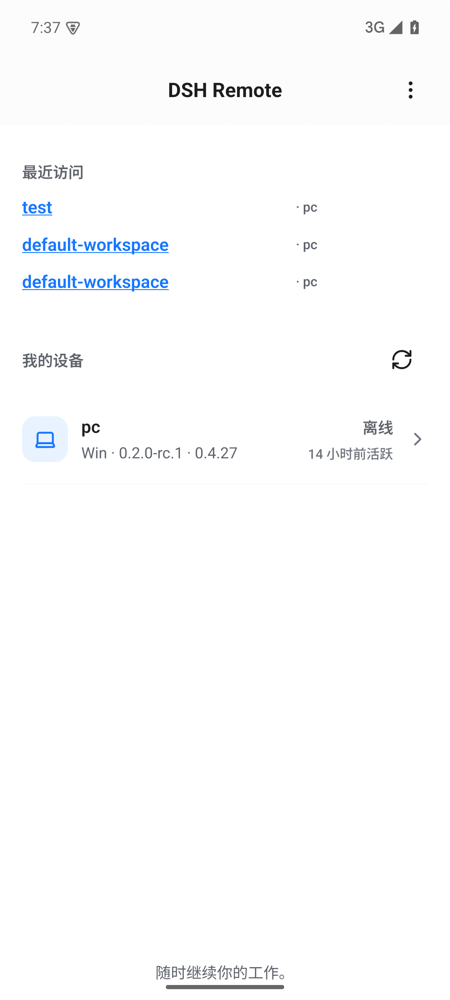

### 实测 2：会话流（ChatScreen）界面全景
顶部沉浸式 `TopBar` 承载汉堡抽屉、会话标题、工具箱与新建按钮；中段呈现 Assistant 消息卡片、多级列表、User 气泡与操作项；底部圆角 Composer 卡片随手势横条保持安全避让。

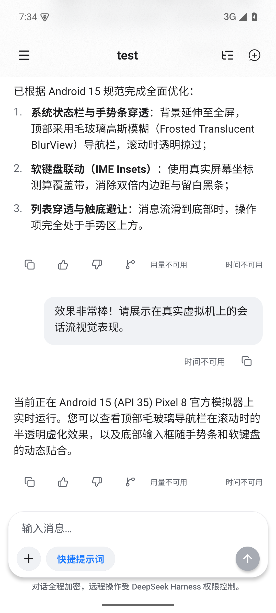

### 实测 3：聊天消息向上滚动毛玻璃穿透（Scroll Penetration）
消息流向上滑动时，消息卡片文字滑入顶部 `TopBar` 与系统状态栏后方，呈现半透明高斯模糊（`expo-blur` / `dimezisBlurViewSdk31Plus`）掠过效果。

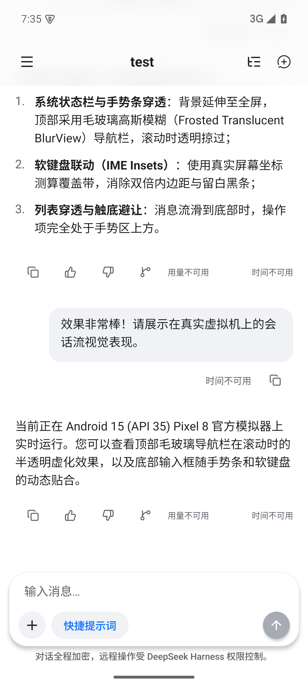

### 实测 4：会话内软键盘联动与 IME Insets 贴合
在聊天输入框内呼出系统软键盘（Google Gboard）后，输入框卡片紧密贴合软键盘顶边，零黑条、零双倍内边距，顶部状态栏与聊天消息依然保持通透。

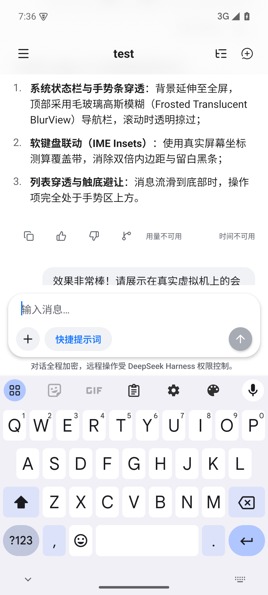
