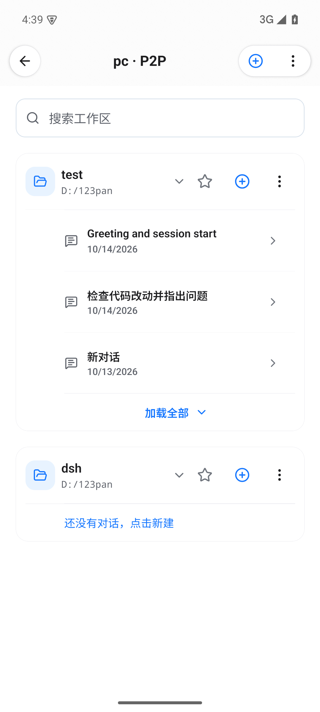
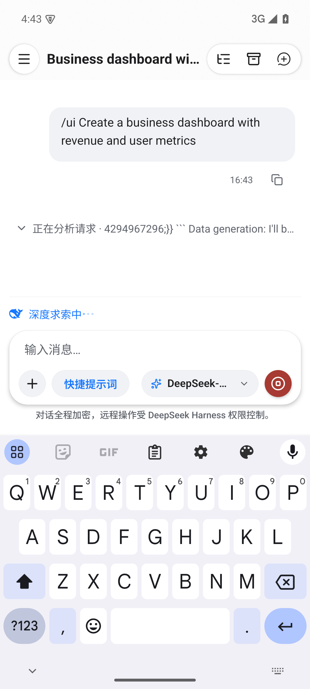
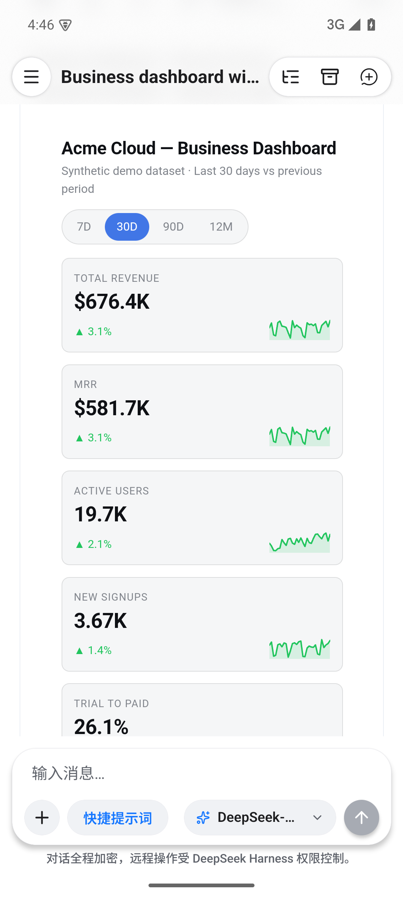
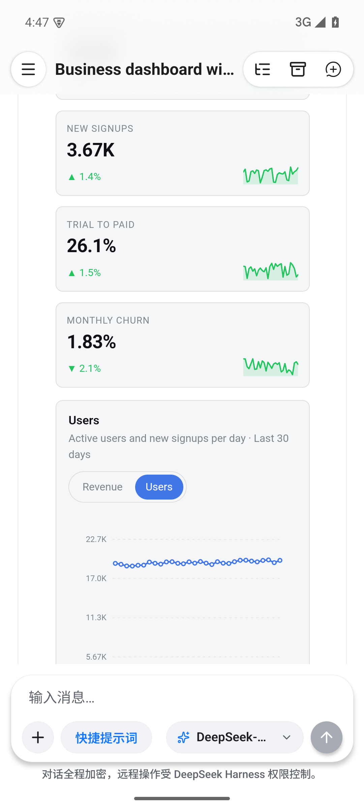
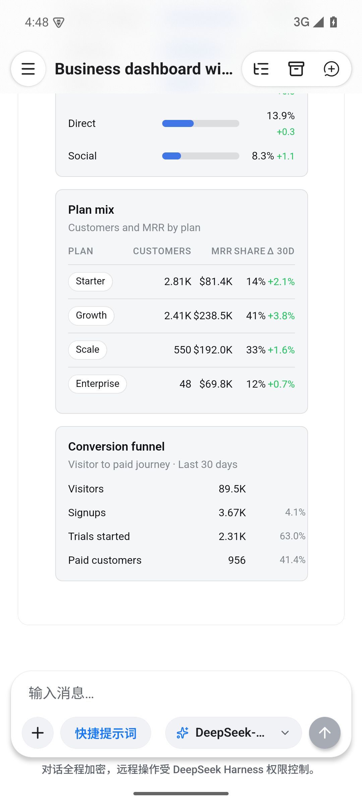

# Issue #124 / PR #126：Android 端 Intelligent UI 交互卡片实测截图

本目录记录 [PR #126](https://github.com/liguobao/ds-harness-remote/pull/126)（关联 Issue #124）在 Android 远程客户端与真实 Host / DeepSeek API 联调的端到端运行截图。

## 验证环境

- **客户端**：Android 15 (API 35, x86_64, 1080 × 2400)，运行包含 PR #126 离线打包独立渲染器（`intelligent-ui-renderer-code.ts`）的 Release APK。
- **服务端 (Host)**：DSH Web（Profile: `web`，已安装 `deepseek-harness-intelligent-ui` 插件）。
- **模型配置**：本地配置的真实 DeepSeek API（`DeepSeek-V41-Flash`，推理强度 High）。
- **加密链路**：自适应协商至本地局域网 P2P 直连通道（`pc · P2P`）。

## 实测截图（两两并排）

| 1. 设备直连与工作区识别 (`pc · P2P`) | 2. DeepSeek 流式思考与调度 |
| :---: | :---: |
|  |  |
| 客户端通过 P2P 加密直连本地电脑 Host，成功加载工作区与历史会话列表。 | 发送 `/ui` 提示词，模型流式输出思考过程（Thinking Tokens），调度 `ui_render`。 |

| 3. 指标看板卡片与走势图 | 4. 本地免请求响应交互 |
| :---: | :---: |
|  |  |
| 离线 WebView 成功渲染卡片概览，包含 7D/30D/90D/12M 切换器、核心指标卡及带渐变走势图。 | 点击图表分段控制器 `[Users]`，图表在端侧本地秒级重绘，无需往返服务器。 |

| 5. 复合组件（进度条、数据表与漏斗） | 6. 实测结论与合入评估 |
| :---: | :---: |
|  |  • **离线独立渲染器**：Bundle（~314 KB）在 Android WebKit 中加载顺利，高度自适应精确无抖动。  • **端侧免请求交互**：分段切换、动态重绘等纯前端本地响应，不消耗额外模型 Token。  • **验证边界**：静态截图不能证明恶意消息拒绝、网络隔离或重连安全。  • **渲染证据**：展示 `ui_render` 卡片及本地切换；回传与连续 Patch 仍待设备验证。 |
| 向下滚动展示渠道占比柱状进度条、方案分类数据表格（Plan mix）与访客转化漏斗。 | 已展示连接、卡片渲染与本地交互；完整双向闭环仍待验证 |

## 验证结论

1. 离线打入 APK 的独立渲染器 Bundle（~314 KB）在 Android WebKit 中加载无异常，样式与高度自适应计算精确。
2. 交互分段切换、动态重绘等功能全部在本地闭环运行，不消耗额外模型 Token。
3. 截图支持 `ui_render` 卡片展示与本地切换，不足以独立证明原生确认 → Session Prompt → 连续 `ui_patch`、弱网/重连或非法 WebView 消息的安全行为。这些设备级验收仍待补充。
